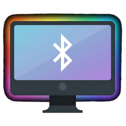

# OpenTuya Sync

**Ambilight для любых ламп и светодиодных лент.** Программа снимает цвет с
экрана, берёт его из звука или мигает — и передаёт на устройства. Работает
с Tuya, WLED, Philips Hue и дешёвыми Bluetooth-лентами (LotusLamp X,
ELK-BLEDOB, NBBUFF).

Написана на **C# / .NET 10 / WPF** под Windows. Работает с
полноэкранными 3D-играми, почти не нагружает процессор, умеет
устанавливаться службой и запускаться вместе с системой.



---

## Возможности

- **Ambilight с экрана** — захват через DXGI Desktop Duplication, видит
  полноэкранные игры. Около **0,5 % одного ядра**.
- **Режим музыки** — цвет из звука через WASAPI, реакция на басы.
- **Режим вспышек** — стробоскоп с настройкой частоты.
- **Устройства:** Tuya, WLED, Philips Hue, Bluetooth-ленты.
- **Служба Windows** — подсветка работает при закрытом окне.
- **Горячие клавиши** — запуск, смена источника, яркость.
- **Автозапуск** вместе с Windows и сворачивание в трей.
- **Пределы яркости** — минимум и максимум, меняются на лету.
- **Поиск устройств** — сканирование сети и поиск по Bluetooth.
- **Цветовой тест** — отдельная программа для проверки подсветки.

---

## Быстрый старт

1. Скачайте **`OpenTuyaSync-v1.0.0.zip`** со страницы
   [Releases](../../releases/latest) и распакуйте в удобную папку.
2. Запустите **`НАСТРОИТЬ.bat`** — он установит службу и откроет программу
   (потребуется подтверждение администратора).
3. В приложении откройте вкладку **«Настройки»** и добавьте устройство.
4. Перейдите на вкладку **«Автоматически»** и нажмите **«Запустить»**.

Подробно: **[СПРАВКА.md](csharp/СПРАВКА.md)** — установка, настройка
каждого типа устройств, режимы, решение проблем.

**Требования:** Windows 10 версии 1903 или новее, .NET 10.

---

## Поддерживаемые устройства

| Тип | Что это | Что нужно |
|---|---|---|
| **Tuya** | умные лампы и ленты из Smart Life / Tuya Smart | Device ID, IP-адрес, Local Key |
| **WLED** | самосборные ленты на ESP | IP-адрес контроллера |
| **Philips Hue** | лампы через Hue Bridge | адрес моста, логин (по кнопке сопряжения) |
| **ELK-BLEDOB** | дешёвые Bluetooth-ленты: LotusLamp X, NBBUFF, LED-… | MAC-адрес (находится поиском) |

---

## Как это устроено

Программа разделена на две части, и это не случайность.

| Часть | Где работает | Чем занимается |
|---|---|---|
| **OpenTuyaSync.Service** | служба Windows | подключение к устройствам, протоколы, рассылка цвета |
| **OpenTuyaSync** | сеанс пользователя | интерфейс, захват экрана, звук, горячие клавиши |

**Служба Windows работает в изолированном сеансе 0** — она не видит экран
пользователя. Это ограничение операционной системы, а не выбор
реализации. Поэтому захват экрана делает приложение, а служба держит
устройства подключёнными, чтобы подсветка работала при закрытом окне.

По той же причине **Bluetooth-ленты обслуживает приложение**: устройства
Bluetooth Low Energy недоступны из сеанса 0. Сетевые устройства (Tuya,
WLED, Hue) обслуживает служба.

Приложение и служба общаются через локальный сокет на петлевом интерфейсе
(`127.0.0.1`). Снаружи он недоступен, брандмауэр не затрагивается.

---

## Проверка подсветки

В релизе есть отдельная программа **Color Test** — она заливает экран
плавно меняющимся градиентом. Нужна, чтобы убедиться, что лампа следует за
изображением, и посмотреть, насколько плавно устройство принимает смену
цвета.

```
tools\ColorTest\OpenTuyaSync.ColorTest.exe
```

От 2 до 10 цветов, пять эффектов (переливание, стробоскоп, по диагонали,
из центра, вращение), скорость и яркость. Полный экран — `F11`.

---

## Сборка из исходников

Требуется **.NET SDK 10** и **Python с Pillow** (только для сборки иконки).

```bash
cd csharp
dotnet build OpenTuyaSync.slnx -c Release   # сборка
publish-release.cmd                         # релиз в csharp\Releases
publish.bat                                 # отладочная сборка в csharp\dist
build-tools.bat                             # утилиты диагностики
```

Релиз получается около **29 МБ** и не требует установленного рантайма в
комплекте — используется системный .NET.

Иконка собирается скриптом:

```bash
python csharp/assets/make_icon.py
```

---

## Состав проекта

```
csharp/
  OpenTuyaSync.Core/        настройки, цветовая математика, протокол обмена
  OpenTuyaSync.Capture/     захват экрана (DXGI + GDI), звук (WASAPI)
  OpenTuyaSync.Providers/   Tuya, WLED, Hue, ELK-BLEDOB
  OpenTuyaSync.Service/     служба Windows и установщик
  OpenTuyaSync.Agent/       приложение: интерфейс, трей, горячие клавиши
  tools/                    утилиты диагностики и Color Test
  assets/                   иконка и её исходник
  СПРАВКА.md                руководство пользователя
  README.md                 документация для разработчика
```

---

## Диагностика

Если что-то не работает, в папке программы есть журналы:

| Файл | Что пишет |
|---|---|
| `service_link.log` | связь приложения со службой: сбои и их причины |
| `agent_crash.log` | ошибки приложения, если оно падало |

В `csharp/tools` есть утилиты для проверки по частям: захват экрана,
связь со службой, Bluetooth, поиск устройств.

Документация для разработчика — [csharp/README.md](csharp/README.md):
архитектура, сборка, подпись, найденные и исправленные ошибки.

---

## Лицензия

См. [LICENSE](LICENSE).
